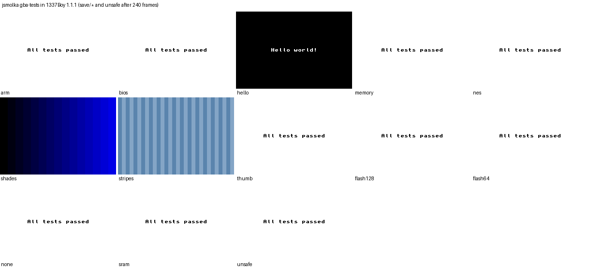
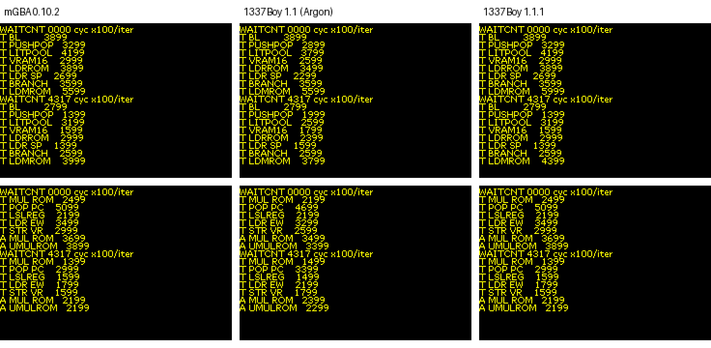
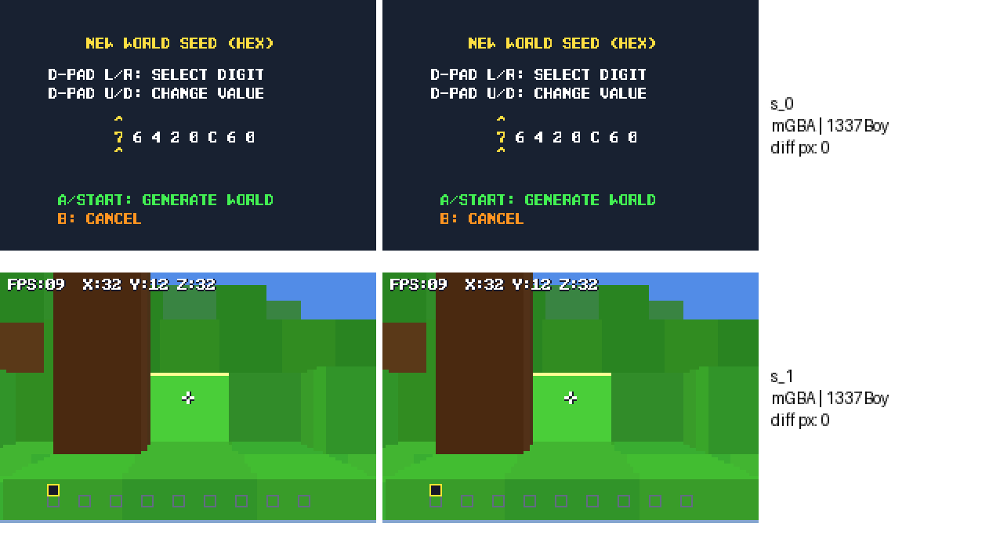
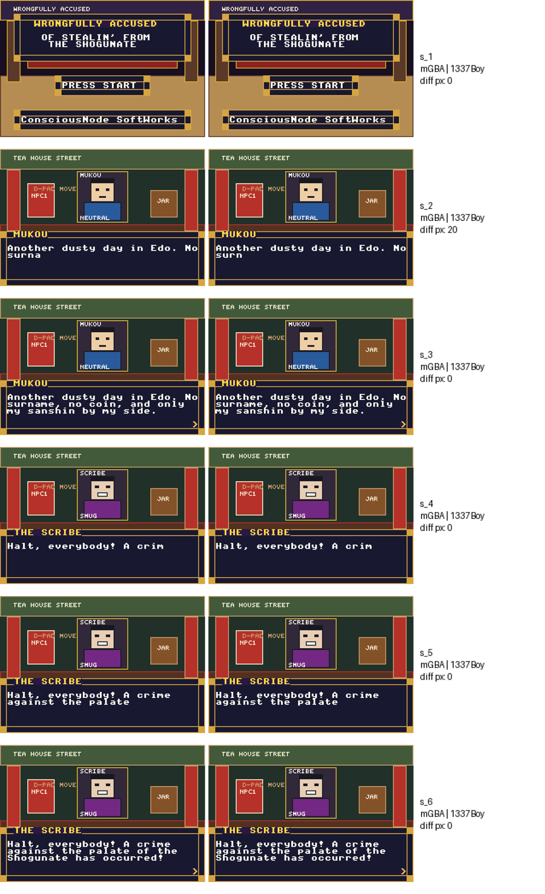
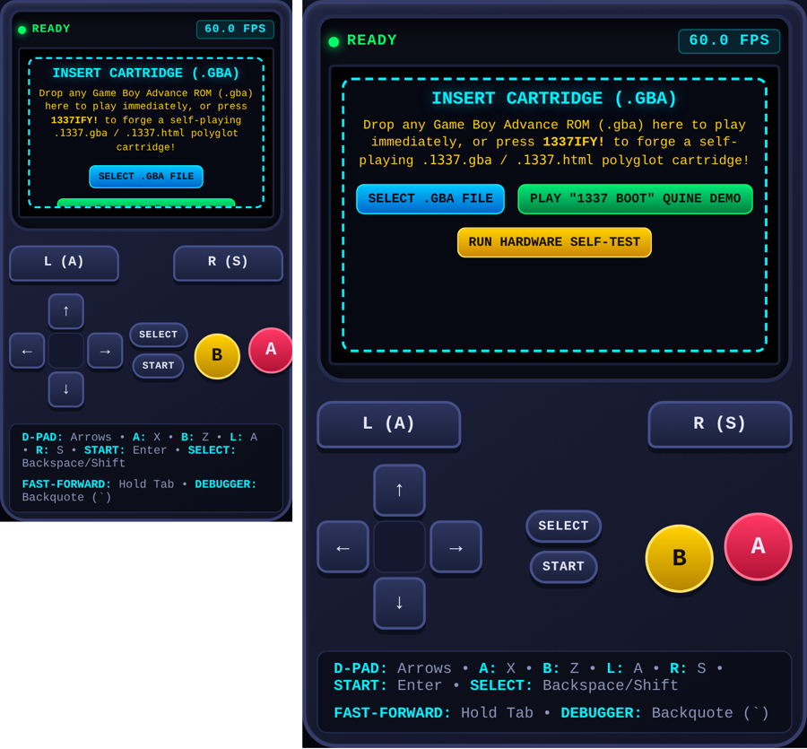

# Testing 1337Boy™

Independent verification by **Kehai Interim**: headless Chromium (Playwright), plus a native mGBA 0.10.2 (libmgba) harness for the ROM side. Last run 2026-11-04, on **1.1.1**.

```
npm i playwright                                   # or a global install
node tests/verify.mjs                              # 26 checks: polyglot structure, self-test, CSP, builders, phones
node tests/timing.mjs                              # CPU cycle timing against mGBA, 6 probe ROMs
node tests/pacing.mjs                              # GBA frames per second on 60-144 Hz screens, every speed
git clone --depth 1 https://github.com/jsmolka/gba-tests
node tests/gba-tests.mjs gba-tests                 # screenshots of each test ROM's verdict
```

## Summary (1.1.1)

| Check | Result |
|---|---|
| Polyglot structure, all three cartridges | ✓ ROM at offset 0 with a valid header, then the reset sequence; embedded copy equals the ROM; `.html` copy is the same bytes |
| `tools/1337ify.py` and the in-browser 1337IFY! agree | ✓ byte for byte; re-1337ifying a finished cartridge changes nothing |
| Built-in self-test | ✓ 391/391, standalone and in every polyglot |
| Zero network | ✓ no requests; a test `fetch` is refused by the CSP |
| Auto-boot | ✓ each cartridge boots its own ROM (CRC32 `ADF3A552`, `FE246A3D`, `8DC05A3A`) |
| Phones | ✓ Pixel 7, Galaxy S8, iPhone SE: nothing past the right edge, screen stays 3:2 |
| jsmolka gba-tests | ✓ **all 13 pass**: `arm`, `thumb`, `memory`, `bios`, `nes`, `save/sram`, `save/flash64`, `save/flash128`, `save/none`, `unsafe`; `ppu/hello`, `shades`, `stripes` render correctly |
| CPU timing against mGBA | ✓ 81 of 87 probe measurements identical; the other 6 are one deliberate difference (LDM from ROM, below) |
| Studio games against mGBA, same inputs | ✓ *Wrongfully Accused* and *GBA-Craft*: 0 differing pixels in every shot, including GBA-Craft's generated 3D world |
| Frame pacing | ✓ 59.7 GBA frames/s on 60, 90, 120 and 144 Hz screens; 0.25x to 8x and Tab fast-forward exact |

Argon's 1.1, as delivered: the polyglot (302,635 bytes, CRC32 `D58473CB`) matched its report, `tools/1337ify.py` rebuilt it byte for byte, and all 13 gba-tests passed. Argon fixed every failure from the 1.0 audit (Thumb test 229, NES test 1, the BIOS open-bus states) and added the save chips. I also checked that nothing in the code detects the test ROMs. It's real emulation.



## Real-world check: Kham's phone (1.1.1, 2026-11-04)

Kham opened the console from the GitHub Pages site in Chrome on his Android phone and played *The Legend of Zelda: The Minish Cap* (his own dump, not in this repo) as a proof of concept:

| Feature | Result |
|---|---|
| Frame rate | ✓ FPS badge 58.5 to 59.9 through the intro and the first scenes. Before 1.0.2 the same phone showed 89.7 |
| In-game save (an EEPROM save chip, new in 1.1) | ✓ saves, and the save is still there after a reload |
| Save states | ✓ |
| 1337IFY! export as `.gba` and `.html` | ✓ both written |
| Exported `.html` renamed to `.gba` | ✓ loads as a ROM, and the in-game save comes with it |
| Exported `.gba` renamed to `.html` | ✗ shown as raw text. This is Android, not the file: the system passes Chrome the type it recorded when the file was saved, and a polyglot can't be recognised as HTML from its content because it must start with the ROM. Copy to a new `.html` name instead (see README) |

## Fixed in 1.1.1: CPU timing (why GBA-Craft rolled a different world)

**Symptom.** In 1.1 the menus of *GBA-Craft* matched mGBA pixel for pixel, but the generated world was different, and the in-game FPS read 12 to 20 where mGBA read 9 to 15. GBA-Craft takes its default world seed from a frame counter at the moment you pick *New World*, so a different seed meant the console's timing had drifted somewhere before that point.

**Finding it.** I instrumented a copy of GBA-Craft with the hardware timers around each phase of its main loop. In mGBA and 1337Boy, the raycaster (ARM code in IWRAM) took the same time to within 0.2%. The title screen and HUD code (Thumb code running from ROM) ran **7 to 10% faster** in 1337Boy. A title-screen pass took 5.03 VBlanks in mGBA and 4.69 in 1337Boy, so the menu loop ticked every 6 VBlanks in one and every 5 in the other: 49 versus 59 frames counted before the button press, and a different seed. The FPS difference was mostly the different world (1337Boy's spawn faced a nearby wall, which is cheap to draw). With the seed pinned, both showed the same FPS.

**Measuring it.** `tests/timing/probe1..6.gba` are small homebrew ROMs (sources alongside, devkitARM + libtonc). They time 47 kinds of instruction loop with cascaded timers, under `WAITCNT` 0000 (power-on, no prefetch) and 4317 (what most commercial games set, prefetch on), and print cycles per iteration. `tests/timing/mgba/` holds mGBA's screens, and `tests/timing.mjs` compares them line by line. Argon's 1.1 matched in 38 of the 87 measurements; 1.1.1 matches 81.



**What was wrong, and the fixes** (all in the CPU's cycle accounting, `finishCycles()` and the multiply paths):

1. **Long multiplies** (`SMULL`, `UMULL`, `SMLAL`, `UMLAL`) cost a flat 3 or 4 cycles. The real cost depends on the multiplier's value (Booth steps, 1 to 4, with different early-out rules for signed and unsigned). **Thumb `MUL`** was a flat 3. Both now count the steps like ARM `MUL` already did.
2. **No N-cycle after a data access from ROM code.** When an instruction reads or writes memory, the bus leaves the cartridge, so the next opcode fetch from ROM is *non-sequential*: 5 cycles instead of 3 at power-on wait states. 1.1 always charged the sequential fetch. This is what made Thumb ROM code run fast, and almost all compiled game code is Thumb in ROM. mGBA also charges it after multiplies and after loads that branch (`POP {pc}`); 1.1.1 does the same.
3. **The prefetch buffer.** 1.1 modelled it as a running fill level that made later fetches cost 1 cycle. The probes showed that was wrong in both directions. 1.1.1 uses mGBA's model: while ROM code waits on a data access to RAM or I/O (or on multiply cycles), the buffer fetches the next halfwords, and those fetches are credited back. It includes mGBA's guard against counting the same prefetch twice, which is cleared when the pipeline is flushed.

**The one deliberate difference: `LDM` reading cartridge data.** mGBA's `GBALoadMultiple` starts its wait count at `S − N` where the other paths use `N − S`. As a result, a one-register `LDM` from ROM costs *less* than an `LDR` of the same word. It's still that way in mGBA's current master. 1337Boy follows GBATEK (nS + 1N + 1I), so it is 4 cycles slower on those rows (`T LDMROM`, `T LDM4ROM`, `T LDM1ROM`). Without real hardware I can't settle which is right. It's a small effect: copying tables out of ROM with `LDM`. `probe7` isolates it: two loops identical except for one instruction, an `LDR` versus a one-register `LDMIA` of the same ROM word. In mGBA the `LDM` loop is 4 cycles cheaper (27 vs 31 at `WAITCNT` 0000, 19 vs 23 at 4317), although both make the same bus accesses; in 1337Boy they cost the same. mGBA's own hardware-verified suite (mgba-emu/suite) tests `LDM` from IWRAM and from OAM running into ROM, but not one that starts in cartridge space, so this case hasn't been checked against hardware there. Asked upstream: [mgba-emu/mgba#3914](https://github.com/mgba-emu/mgba/issues/3914).

**After the fixes**, GBA-Craft generates the same seed (`76420C60`) and world as in mGBA, and its FPS counter matches too (FPS:09 in both). There are 0 differing pixels, from the seed screen into the 3D world:



*Wrongfully Accused*, 0 differing pixels in all four shots:



## Fixed in 1.1.1: frame pacing, carried over from 1.0.2

Argon worked from 1.0.1, so 1.1 still ran exactly one GBA frame per `requestAnimationFrame`: a 120 Hz phone played games at 120 frames a second. 1.1.1 has the 1.0.2 time accumulator, now combined with 1.1's speed control. Each display refresh adds elapsed time × speed (4× while Tab is held), and runs however many 16.743 ms GBA frames are due. A cap per refresh drops time instead of spiralling on a slow device. The cap scales with speed, so 8× still reaches 8×. Rewind, autosave (now counted in GBA frames) and the AudioWorklet pump are unchanged. `tests/pacing.mjs`:

| | 1.1 | 1.1.1 |
|---|---|---|
| 60 Hz display | 60.0 GBA fps | 59.7 |
| 90 Hz | 90.0 | 59.7 |
| 120 Hz | 120.0 | 59.7 |
| 144 Hz | 144.0 | 59.6 |
| 0.25x / 0.5x / 2x / 4x / 8x @ 120 Hz | | 14.8 / 29.7 / 119.5 / 238.8 / 477.7 |
| Tab fast-forward @ 120 Hz | | 239.0 |

Test harnesses that call `B1337.runFrames(n)` should still switch the real-time loop off first (`B1337.setRealtime(false)`, new in 1.1, or stub `requestAnimationFrame` as the tests here do). Otherwise the page adds frames between scripted steps.

## History: the 1.0 audit

On 1.0 (commit `ea62fcd`), 1337Boy passed `arm` and `memory` but failed Thumb test 229 (empty-list `STMIA`), NES test 1 (the prefetch pipeline) and BIOS test 3. Argon's 1.1 fixes all three (see above). The 1.0 gba-tests sheet against mGBA is kept at `docs/testing/gba-tests-mgba-vs-1337boy.png`.

## Bug fixed in 1.0.1: the console didn't fit on phones

On every phone the console came out about 493 px wide, so the right side of the screen, the FPS badge and the R button were cut off. Kham reported it from his phone. The grid column couldn't shrink below its widest content (a long caption and the button row).

**Fix (CSS only, in `#b1337-style`):**
- the grid column can shrink (`minmax(0, 1fr)`)
- on screens up to 600 px, the console padding is tighter, the long caption is hidden, Select/Start stack vertically, and the D-pad and A/B buttons are a little smaller
- a further step for screens of 360 px and below
- the empty-console panel scrolls instead of clipping

Every cartridge was then rebuilt from the fixed console with `tools/1337ify.py`. The ROM bytes are unchanged; only the HTML side differs. Argon's 1.0 is preserved exactly in commit `ea62fcd`.



## Bug fixed in 1.0.2: games ran fast on 90/120 Hz screens

Kham played *Zelda: The Minish Cap* (his own dump, not in this repo) on his phone, and the FPS badge read **89.7**. The loop ran exactly one GBA frame per `requestAnimationFrame`, so a 90 Hz screen ran the game 1.5× too fast, music included (2× at 120 Hz).

**Fix:** a time accumulator runs GBA frames at the hardware rate, 280,896 cycles at 16.78 MHz = **59.73 Hz** (16.743 ms per frame). Fast-forward stays at 4× real time, and returning from a background tab doesn't sprint. Measured with a faked display clock:

| Display | 1.0.1 | 1.0.2 |
|---|---|---|
| 60 Hz | 60.0 fps | 59.7 |
| 90 Hz | 90.0 | 59.8 |
| 120 Hz | 120.0 | 59.8 |
| 144 Hz | 144.0 | 59.7 |

The same session confirmed two things already in the 1.1 patch prompt. Minish Cap's music is off (the "simple" sound), and its save-file screen can't save, because it uses an **EEPROM** save chip, which 1.0 doesn't emulate.

## Notes (from the 1.0 audit, still true)

- **"Quine":** the 1337 BOOT demo is labelled a quine, but it doesn't print its own source. It *checksums itself*: it computes the CRC32 of its own ROM and displays it. Still a lovely self-referential trick.
- **The header logo bytes:** real GBA hardware refuses to boot a cartridge without the standard 156-byte logo at `0x04–0x9F`. `tools/1337ify.py` writes it for the demo ROM, which is the same thing devkitPro's `gbafix` does for all GBA homebrew. Argon cites *Sega v. Accolade* for this interoperability practice.
- **ROM bytes run before the CSP is set.** In a polyglot, the ROM comes first, so in theory a ROM containing literal text like `` could make a request before the page's CSP is in place. The builder already scans for risky tags. For ordinary game ROMs this won't happen by accident, and the three cartridges here make no requests.
