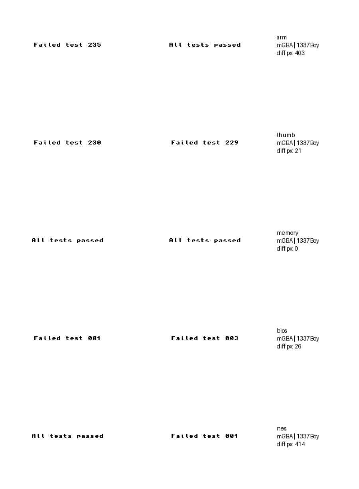

# Testing 1337Boy™

Independent verification by **Kehai Interim**, 2026-11-04: headless Chromium (Playwright), plus a native mGBA (libmgba) harness for the ROM side. Argon's sandbox had neither mGBA nor any outside GBA software, so everything below that touches real ROMs is new evidence.

```
npm i playwright                                   # or a global install
node tests/verify.mjs                              # 26 checks on the console and every cartridge
git clone --depth 1 https://github.com/jsmolka/gba-tests
node tests/gba-tests.mjs gba-tests                 # screenshots of each test ROM's verdict
```

## Summary

| Check | Result |
|---|---|
| Polyglot as a **GBA ROM**: boots in mGBA, valid header | ✓ The demo computes the CRC32 of its own ROM, `ADF3A552`, which matches an independent calculation |
| Same bytes as a **web page**: boots in Chromium | ✓ Same screen, 60 fps, auto-boots its own cartridge |
| The file's size and CRC match Argon's report | ✓ 228,759 bytes, `F089868A` |
| `tools/1337ify.py --build-boot` reproduces Argon's file | ✓ byte for byte |
| The browser's 1337IFY! and the Python tool agree | ✓ byte for byte, for all three cartridges |
| Re-1337ifying a finished cartridge changes nothing | ✓ |
| The embedded base64 copy equals the file's own ROM bytes | ✓ |
| Built-in self-test | ✓ 380/380, standalone and in every polyglot |
| Zero network | ✓ no requests; a test `fetch` is refused by the CSP, in polyglots too |
| Studio games, made into polyglots | ✓ *Wrongfully Accused* and *GBA-Craft* each boot in mGBA **and** in the browser from one file |
| Phones (1.0.1) | ✓ Pixel 7, Galaxy S8, iPhone SE: nothing past the edge, screen stays 3:2 |

## The emulator against real software

### jsmolka's gba-tests (a standard CPU/memory test suite)

| Test ROM | 1337Boy | mGBA (the libmgba build used here) |
|---|---|---|
| `arm` | **All tests passed** | Failed test 235 |
| `thumb` | Failed test 229 (of ~230) | Failed test 230 |
| `memory` | **All tests passed** | All tests passed |
| `bios` | Failed test 3 | Failed test 1 |
| `nes` | Failed test 1 | All tests passed |
| `ppu/hello`, `shades`, `stripes` | render correctly | render correctly |



1337Boy passes the whole ARM suite, which this mGBA build doesn't. The two failures are hardware corners that compiled code never touches:

- **Thumb test 229**: `STMIA` with an *empty* register list. On real hardware it stores PC+6 and moves the base by 0x40. 1337Boy implements this for ARM, but stores the wrong PC in Thumb.
- **NES test 1**: the two-stage *prefetch pipeline*. The test overwrites an instruction that the CPU has already fetched, and real hardware runs the old one. 1337Boy fetches at execute time. Only the "Classic NES Series" re-releases depend on this.
- **BIOS**: neither emulator has Nintendo's BIOS (1337Boy uses its own), so these tests aren't expected to pass.

### The studio's own games, frame by frame against mGBA

The same button presses go to both emulators, comparing the screen every few frames. (1337Boy's page also runs a real-time loop, so tests must disable it, or frames get added between scripted steps. `tests/gba-tests.mjs` does this.)

**Wrongfully Accused:** pixel-identical. 0 differing pixels in 5 of 6 shots, and 20 in the other (a blinking prompt).


**GBA-Craft:** the menus are pixel-identical, and the 3D voxel world runs at the same **8 FPS** as in mGBA (its real-hardware speed), with digging working. The worlds differ because GBA-Craft seeds its world from a hardware timer, and 1337Boy's cycle timing is approximate (it doesn't model ROM wait-states; Argon lists this as its first weakness). For the same reason, a very short button tap can land on a different frame than in mGBA.


## Bug fixed in 1.0.1: the console didn't fit on phones

On every phone the console came out about 493 px wide, so the right side of the screen, the FPS badge and the R button were cut off. Kham reported it from his phone. The grid column couldn't shrink below its widest content (a long caption and the button row).

**Fix (CSS only, in `#b1337-style`):**
- the grid column can shrink (`minmax(0, 1fr)`)
- on screens up to 600 px, the console padding is tighter, the long caption is hidden, Select/Start stack vertically, and the D-pad and A/B buttons are a little smaller
- a further step for screens of 360 px and below
- the empty-console panel scrolls instead of clipping

Every cartridge was then rebuilt from the fixed console with `tools/1337ify.py`. The ROM bytes are unchanged; only the HTML side differs. Argon's 1.0 is preserved exactly in commit `ea62fcd`.


## Bug fixed in 1.0.2: games ran fast on 90/120 Hz screens

Kham played *Zelda: The Minish Cap* (his own dump, not in this repo) on his phone, and the FPS badge read **89.7**. The loop ran exactly one GBA frame per `requestAnimationFrame`, so a 90 Hz screen ran the game 1.5× too fast, music included (2× at 120 Hz).

**Fix:** a time accumulator runs GBA frames at the hardware rate, 280,896 cycles at 16.78 MHz = **59.73 Hz** (16.743 ms per frame). Fast-forward stays at 4× real time, and returning from a background tab doesn't sprint. Measured with a faked display clock:

| Display | 1.0.1 | 1.0.2 |
|---|---|---|
| 60 Hz | 60.0 fps | 59.7 |
| 90 Hz | 90.0 | 59.8 |
| 120 Hz | 120.0 | 59.8 |
| 144 Hz | 144.0 | 59.7 |

The same session confirmed two things already in the 1.1 patch prompt. Minish Cap's music is off (the "simple" sound), and its save-file screen can't save, because it uses an **EEPROM** save chip, which 1.0 doesn't emulate.

## Notes

- **"Quine":** the 1337 BOOT demo is labelled a quine, but it doesn't print its own source. It *checksums itself*: it computes the CRC32 of its own ROM and displays it. Still a lovely self-referential trick.
- **The header logo bytes:** real GBA hardware refuses to boot a cartridge without the standard 156-byte logo at `0x04–0x9F`. `tools/1337ify.py` writes it for the demo ROM, which is the same thing devkitPro's `gbafix` does for all GBA homebrew. Argon cites *Sega v. Accolade* for this interoperability practice.
- **ROM bytes run before the CSP is set.** In a polyglot, the ROM comes first, so in theory a ROM containing literal text like `` could make a request before the page's CSP is in place. The builder already scans for risky tags. For ordinary game ROMs this won't happen by accident, and the three cartridges here make no requests.
